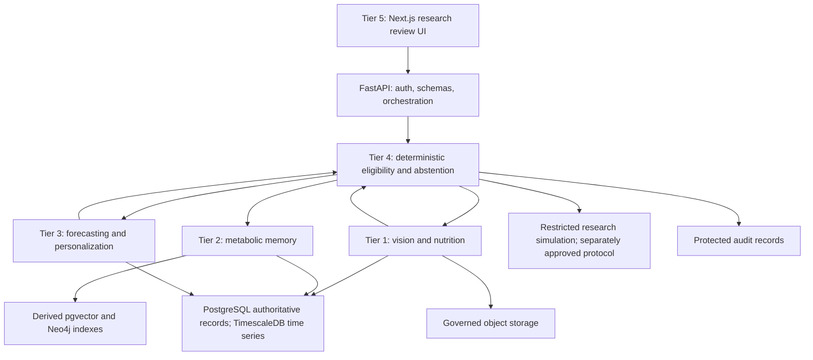
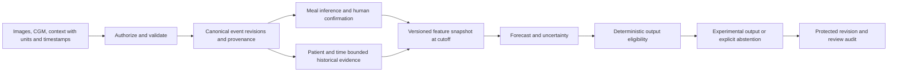
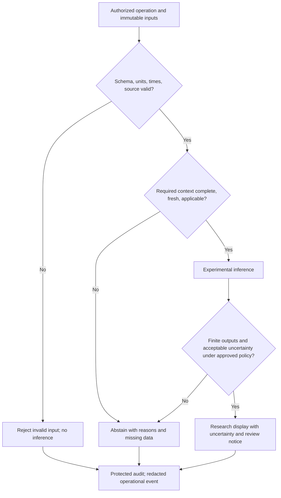

# System architecture

Status: Phase 00 design baseline with Phase 01 foundation and the approved Phase 02 data slice implemented; see the Phase 02 section below. Five tiers and the modular-monolith direction are specified by the project brief; implementation and operational settings are not approved by this document. See [requirements](requirements.md) and [ADRs](decisions/README.md).

## Components and responsibilities
1. **Tier 1 — Vision-to-Nutrition Intelligence:** validate images; detect/segment/classify foods; estimate portions; map versioned nutrient references; return uncertainty and human-correction requirements. Experimental Fat/Protein Unit work is optional research, not a treatment formula.
2. **Tier 2 — Personalized Metabolic Memory:** retrieve patient-scoped historical evidence using structured filters, time bounds, vector similarity, and graph relations. Preserve source revisions and exclude information known only after the prediction timestamp. Retrieval is not a physiological digital twin.
3. **Tier 3 — Glucose Forecasting and Personalization:** build leakage-safe features, compare baselines/advanced candidates, forecast 30/60/90/120-minute glucose with uncertainty and version lineage. No dosing outputs.
4. **Tier 4 — Safety and Clinical Research Simulation:** deterministic input/output eligibility, freshness/completeness checks, uncertainty gates, abstention, and traceable audit. A later restricted simulation may evaluate independently approved clinician-defined protocols; it cannot issue treatment instructions or change settings.
5. **Tier 5 — Human-in-the-Loop Application:** web dashboard, meal/nutrition corrections and confirmation, history, experimental forecasts, evidence, warnings, abstention explanations, and qualified research review.

`apps/api` orchestrates domain modules in `services/`; the directory name does not imply network services. `apps/web` accesses the API only. Domain logic remains independent of transport, persistence adapters, training scripts, and UI. PostgreSQL is authoritative for structured records; TimescaleDB is an extension for time-series management, pgvector for derived embeddings, Neo4j for derived graph retrieval, and object storage for governed image/model objects. Do not introduce Kafka, Kubernetes, or distributed microservices.



## Data flow and trust boundaries
All input is untrusted, including model outputs, retrieval, uploaded files, and LLM content. The API verifies identity and scope before resolving references, validates schemas, establishes a server-side input cutoff, and asks Tier 4 to evaluate operation-specific prerequisites. Output gates run again before a result becomes displayable. Eligibility means research display/use eligibility, never clinical safety clearance. A forecast missing required data becomes an abstention, not a guessed value.



## API orchestration and processing
Use synchronous validation, confirmation, bounded historical queries, and lightweight inference only when measured limits permit. Meal image analysis and slow inference can use asynchronous job contracts. A worker is an optional process using the same modules and gates; Redis is optional pending demonstrated need. Job records live in PostgreSQL with scope, immutable inputs, status, expiry, and idempotency metadata. Queue messages contain opaque authorized references, not medical payloads. Duplicate delivery must not duplicate confirmations or audit semantics. Cancellation/retry must recheck authorization, consent, source revisions, and expiry.

```mermaid
sequenceDiagram
    actor User as Research reviewer
    participant UI as Web UI
    participant API as API orchestrator
    participant S as Safety module
    participant V as Vision and nutrition module
    participant DB as Canonical store
    User->>UI: Submit meal image and capture time
    UI->>API: Authorized upload
    API->>S: Validate media, scope, metadata
    alt Invalid or unsupported
        S-->>API: Reject or abstain with reason codes
        API-->>UI: Structured failure
    else Valid
        API->>DB: Store governed upload and job references
        API->>V: Analyze immutable image reference
        V-->>API: Candidates, portions, uncertainty, provenance
        API->>S: Evaluate result eligibility
        API-->>UI: Job result; human confirmation required
        User->>UI: Correct and confirm nutrients
        UI->>API: Expected revision and confirmed values
        API->>DB: Append confirmed revision and audit event
    end
```

```mermaid
sequenceDiagram
    participant UI as Research UI
    participant API as API orchestrator
    participant S as Deterministic safety module
    participant M as Metabolic memory
    participant F as Forecast module
    participant DB as PostgreSQL
    UI->>API: Request forecast for patient and cutoff
    API->>DB: Authorized immutable event snapshot
    API->>S: Check units, quality, freshness, applicability
    alt Ineligible
        S-->>API: Abstention reasons and missing data
    else Eligible for experimental inference
        API->>M: Retrieve same-patient evidence known by cutoff
        M-->>API: Versioned evidence or unavailable status
        API->>F: Validated features and required evidence
        F-->>API: Four horizons, intervals, model version
        API->>S: Validate output and uncertainty
        S-->>API: Eligible or abstained
    end
    API->>DB: Persist evaluation, lineage, audit references
    API-->>UI: Experimental result or abstention; no dose
```



## Training and inference separation
Offline `ml/training` never runs in a request handler. `ml/experiments` tracks configuration; `ml/evaluation` evaluates locked patient/time splits. Approved candidate artifacts enter a versioned registry only after evaluation and human review. Inference loads an immutable model/preprocessing manifest with supported input units, feature schema, horizons, applicability, and uncertainty method. An unapproved, missing, incompatible, or corrupt artifact results in abstention. Models cannot update clinical parameters. External multimodal providers remain optional and unavailable for protected data until governance review.

## Persistence and consistency
A transaction writes canonical event revisions plus outbox/index-update metadata and protected audit references. Graph/vector updates are derived, idempotent, revision-aware, and eventually consistent. Retrieval checks canonical ownership and knowledge-time after candidate search; stale/deleted candidates are excluded. PostgreSQL failure blocks operations requiring history/audit; graph outage may permit an explicitly documented structured-only retrieval mode only for a model validated for that mode. Never silently substitute a different model or impute treatment context. See [memory design](memory-architecture.md) and [data model](data-model.md).

## Failure handling and observability
Distinguish transport/schema errors, unauthorized access, domain conflicts, dependency failures, job timeouts, and valid research abstention. Return stable reason codes and correlation IDs without internal stack traces. Bounded retries apply only to transient idempotent operations; finite timeouts and upload/batch limits are configured only after measurement. Track latency, dependency availability, gate reasons, model version, and revision consistency without medical payloads. Protected audit failures fail closed for operations requiring traceability. OpenTelemetry/Sentry export requires redaction and governance approval.

## Deployment design, not settings
Proposed local topology: a web process, API process, PostgreSQL/extensions, optional Neo4j, object storage adapter, and later optional worker/Redis under Docker Compose. This is a design, not executable deployment configuration. No ports, credentials, public exposure, cloud account, production region, or retention interval is approved. Phase 10 needs a reviewed threat model, synthetic integration/recovery evidence, and explicit deployment approval. Phase 01 should begin with the smallest runnable backend slice and add stores at their roadmap phases, not start the full infrastructure stack prematurely.

## Phase 01 foundation status
The user approved a limited Phase 01 timing addition on 2026-11-01: a minimal web connectivity shell and optional local PostgreSQL/Neo4j configuration. This does not implement the Tier 5 clinical workflows or later database/graph features. The API has only health and a fail-closed session-read boundary; optional stores are not connected to enabled API capabilities. Plain PostgreSQL is a documented local fallback while exact TimescaleDB/pgvector image compatibility is unverified. This note records the approved scope addition without changing the five-tier design, database authority or clinical boundaries.

## Phase 02 implemented data slice

See [ADR-006](decisions/ADR-006-phase02-isolated-timescale-and-rls.md). An isolated PostgreSQL 17.10/TimescaleDB 2.29.0/pgvector 0.8.1 instance is the authoritative structured research store. Phase 01 PostgreSQL/Neo4j remain separate. Only CGM is a hypertable; vector capability is enabled but unused. No derived graph, embedding, forecast, worker or clinical simulation is implemented.

FastAPI routers validate transport and inject the existing principal/database; data schemas enforce explicit units/provenance; DataService owns atomic ingestion, revisions, audit and reconstruction; EventRepository applies patient-scoped point-in-time SQL; db models/session and frozen Alembic SQL own persistence, constraints, RLS and role checks. Sessions are scoped to operations/requests with bounded pooling/timeouts; process liveness stays independent of configured database readiness. The frontend remains the connectivity shell.

EventRevision separates UUID identity from time-inclusive CGM keys, preserves original source revisions and server knowledge times, and references immutable typed payloads. DataSource, Study, ConsentRecord and AccessGrant support explicit authorization/provenance. Audit and outbox records contain references instead of duplicated clinical payloads. Four speculative canonical entities are explicitly deferred in [data model](data-model.md). No production identity provider or real research data is authorized by these structures.
