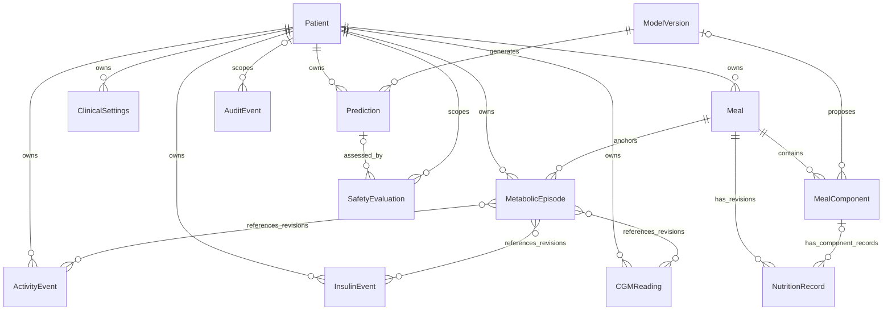

# Canonical data model

Status: Proposed contract design; no clinical tables, migrations, or clinical application types exist. Phase 01 health/error/principal types are separate engineering contracts. See [API contracts](api-contracts.md), [memory architecture](memory-architecture.md), and [ADR-002](decisions/ADR-002-database-strategy.md).

## Shared conventions
All entities have required `id: UUID`, `schema_version: integer`, `created_at: timestamptz`, and `provenance: Provenance`. UUIDs are opaque application-generated identifiers, not personal identifiers. Patient-owned records additionally require `patient_id: UUID` referencing Patient and `study_id: UUID`; study and user/grant records will be specified before Phase 02. Every relationship must preserve the same patient and study scope, enforced by authorization and database constraints where possible.

`Provenance` is required JSON with `source_type: enum(synthetic, device, manual, dataset, model, derived)`, `source_ref: opaque string`, `source_version: string`, `recorded_at: timestamptz`, and `transformation_version: string|null`. References must resolve to a protected manifest or revision; never embed names, credentials, or raw data in lineage fields. Manual entries require actor reference in the protected audit trail.

Clinical event entities (CGMReading, Meal, InsulinEvent, ActivityEvent, ClinicalSettings, MetabolicEpisode) also have required `event_time: timestamptz`, `available_at: timestamptz`, `revision: positive integer`, `supersedes_id: UUID|null`, and `quality_flags: string[]`. `available_at` means the earliest time that this revision and its complete content were usable by this system, and cannot precede source availability/ingestion. It is distinct from the time the event happened. Dataset backfill must not make late annotations appear available earlier. Retrospective studies lacking original knowledge-time must disclose that limitation and use a conservative documented reconstruction, never assert an unbiased online result.

Canonical timestamps are UTC timezone-aware; wire format is RFC 3339 with `Z`. Preserve original timezone/offset in protected provenance if necessary. Durations specify minutes; glucose requires explicit `mg/dL` or `mmol/L`, insulin `U`, nutrients `g`, energy `kcal`, portion mass `g`. No unit guessing. Preserve submitted unit/value; derived conversions require explicit conversion version and tests. Select any canonical numeric normalization in Phase 02 rather than silently conflating units. JSON numbers must be finite. SQL numeric precision/ranges and operational size limits are **Pending approval**, with no silent truncation.

In the definitions below, **R** means required/non-null and **O** means optional/nullable. Empty lists are explicit, not substitutes for missing required clinical context. Immutable revisions preserve corrections; logically superseded/deleted content is excluded from retrieval. Sensitive content is never used as an operational log label.

## Patient
- R `study_id: UUID`, `research_subject_ref: opaque string`, `status: enum(active, withdrawn, suspended)`, `consent_ref: UUID`, `consent_version: string`.
- O `cohort_labels: string[]`, `timezone: IANA string`, `withdrawn_at: timestamptz`.
- One patient owns many events, meals, episodes, predictions, and settings revisions. Unique research reference within a study. No name, email, date of birth, address, or re-identification key in this domain schema; any later identity linkage requires separately governed storage. Verify current consent/grant before processing; a consent reference alone is not authorization.

## CGMReading
- R event envelope; `glucose_value: decimal`, `glucose_unit: enum(mg/dL, mmol/L)`, `source_event_ref: string`, `device_ref: opaque string`.
- O `sensor_status: string`, `source_accuracy_metadata: JSON`.
- Patient many-to-one; optional membership in multiple episode manifests via referenced revisions. Value must be finite and positive; device/profile ranges and freshness limits require an approved versioned policy. Detect duplicates by scoped device reference and source event, validate clock skew, gaps, and invalid sensor statuses. Do not forward-fill without an evaluated feature policy.

## Meal
- R event envelope; `status: enum(draft, analyzed, confirmed, rejected)`, `meal_revision: positive integer`, `component_ids: UUID[]`.
- O `image_object_ref: opaque string`, `captured_at: timestamptz`, `confirmed_by: UUID`, `confirmed_at: timestamptz`, `nutrition_record_id: UUID`.
- Owns MealComponents and revision-specific aggregate NutritionRecord. Image references use scoped object metadata, not public URLs. Confirmation requires reviewed components, explicit portions, complete nutrient-source lineage, actor authorization, and optimistic concurrency; a confirmed meal may be a manual entry without an image. Revisions invalidate prior downstream feature snapshots.

## MealComponent
- R patient/study envelope; `meal_id: UUID`, `meal_revision: integer`, `food_label: string`, `status: enum(proposed, corrected, confirmed, rejected)`.
- O `portion_value: decimal`, `portion_unit: enum(g)`, `confidence: decimal`, `segmentation_object_ref: string`, `food_reference_id: string`, `nutrition_record_id: UUID`, `uncertainty: JSON`, `model_version_id: UUID`.
- Meal many-to-one. Missing portion is allowed in a draft but blocks confirmation/estimation eligibility; positive finite portion when present. Confidence in [0,1] is not necessarily calibrated probability. No unsupported visual volume-to-mass assumption. Corrected values preserve original inference lineage.

## NutritionRecord
- R patient/study envelope; `meal_id: UUID`, `meal_revision: integer`, `scope: enum(component, meal_total)`, `carbohydrate_g: decimal`, `protein_g: decimal`, `fat_g: decimal`, `energy_kcal: decimal`, `reference_manifest: JSON`, `method_version: string`, `uncertainty: JSON`, `available_at: timestamptz`.
- O `component_id: UUID`, `experimental_fpu: JSON`, `reviewed_at: timestamptz`, `reviewed_by: UUID`.
- Many records can represent historical revisions; only one active total for a confirmed meal revision. Nutrients finite/nonnegative, with ingredient/portion plausibility reviewed; totals refer to component revisions. `uncertainty` declares method, units, intervals or explicit unknown status. Experimental FPU must name its independently reviewed definition and assumptions; no formula is selected here and no dosing implication is permitted.

## InsulinEvent
- R event envelope; `event_kind: enum(reported_delivery, planned, cancelled, corrected)`, `amount_value: decimal`, `amount_unit: enum(U)`, `insulin_type_ref: string`, `source_event_ref: string`.
- O `route: string`, `delivery_start: timestamptz`, `delivery_end: timestamptz`, `verification_status: string`.
- Historical records only; planned records never count as delivered exposure. Nonnegative finite value, explicit formulation and timing required by the eventual feature schema. Basal-rate profiles cannot be represented as a unitless dose; any `U/hour` delivery schema needs separate review before implementation. No active-insulin computation is specified or inferred here.

## ActivityEvent
- R event envelope; `activity_type: string`, `start_at: timestamptz`, `end_at: timestamptz`, `intensity_status: enum(known, unknown)`.
- O `intensity_value: decimal`, `intensity_unit: string`, `device_ref: string`.
- Start cannot follow end; `event_time` is the start. If intensity is known both value and unit are required. Missing activity is unknown, not proof of inactivity. Sensitive free text is discouraged.

## ClinicalSettings
- R event envelope; `settings_version: string`, `status: enum(pending, approved, revoked)`, `effective_from: timestamptz`, `parameters: Parameter[]`, `protocol_ref: string`.
- O `effective_to: timestamptz`, `approved_by: UUID`, `approved_at: timestamptz`, `review_due_at: timestamptz`.
- `Parameter` has required `name: string`, `value: decimal|string`, `unit: string`, and `source_ref: string`; an approved schema must enumerate permitted names before use. Examples of fields needing explicit clinician values include target glucose, insulin sensitivity, carbohydrate ratio, and active-insulin context; this document supplies none. Effective intervals cannot overlap for the same approved scope/version. Required approvals must exist and be available by the operation cutoff. Updates append revisions; AI cannot write approvals.

## MetabolicEpisode
- R event envelope; `start_at/end_at: timestamptz`, `anchor_meal_id: UUID`, `source_revision_refs: UUID[]`, `episode_definition_version: string`, `summary_version: string`, `completeness: JSON`.
- O `outcome_summary: JSON`, `embedding_ref: UUID`, `graph_revision: string`.
- Links exact meal, CGM, insulin, and activity revisions. `end_at >= start_at`; `available_at` must include availability of every summarized event/outcome and transformation. A response window extending after the query cutoff is ineligible even if its meal began earlier. Embedding creation/version must also be eligible at cutoff.

## Prediction
- R patient/study envelope; `prediction_time: timestamptz`, `input_cutoff: timestamptz`, `input_snapshot_ref: string`, `model_version_id: UUID`, `status: enum(eligible, abstained)`, `horizons_minutes: integer[]`, `points: ForecastPoint[]`, `safety_evaluation_id: UUID`, `evidence_refs: UUID[]`, `assumptions: string[]`, `missing_data: string[]`, `warnings: string[]`, `experimental: boolean`.
- O `completed_at: timestamptz`.
- `ForecastPoint` requires `horizon_minutes`, `target_time`, `glucose_value`, `glucose_unit`, and `interval: {lower, upper, coverage, method}` with explicit numeric types. Eligible forecasts contain exactly 30/60/90/120-minute points, finite ordered bounds and declared coverage in (0,1). Input and knowledge times cannot exceed cutoff; target times equal cutoff plus horizon. Abstained forecasts have no usable points and retain reasons via SafetyEvaluation. Model evaluation does not prove a per-person interval is reliable. No dose fields.

## SafetyEvaluation
- R patient/study envelope; `operation: string`, `input_snapshot_ref: string`, `policy_version: string`, `evaluated_at: timestamptz`, `input_cutoff: timestamptz`, `status: enum(eligible, abstained, rejected)`, `reason_codes: string[]`, `missing_data: string[]`, `assumptions: string[]`, `warnings: string[]`, `review_required: boolean`.
- O `prediction_id: UUID`, `clinical_settings_id: UUID`, `review_ref: UUID`.
- A precheck may precede Prediction; the final Prediction points to the final evaluation, avoiding a required cyclic insert. Rejected means invalid input, abstained means no eligible research result. Exact policy thresholds are unapproved; missing policy fails closed. Eligibility is never a clinical safety certification.

## AuditEvent
- R `study_id: UUID`, `actor_ref: opaque string`, `action: string`, `resource_type: string`, `resource_id: UUID`, `resource_revision: integer`, `outcome: string`, `correlation_id: UUID`, `occurred_at: timestamptz`.
- O `patient_id: UUID`, `reason_code: string`, `previous_event_ref: UUID`.
- Append-only protected records; no medical payloads or tokens. Actor/resource references are still sensitive metadata and need access control, encryption, retention rules, and audited access. Operational logs receive only non-sensitive correlation metadata, not the protected audit record. Tamper evidence and audit retention design are pending review.

## ModelVersion
- R `model_name: string`, `version: string`, `artifact_object_ref: string`, `artifact_digest: string`, `code_revision: string`, `data_manifest_ref: string`, `feature_schema_version: string`, `preprocessing_version: string`, `evaluation_report_ref: string`, `uncertainty_method: string`, `status: enum(candidate, approved_for_research, retired)`, `applicability: JSON`.
- O `approved_by: UUID`, `approved_at: timestamptz`, `retired_at: timestamptz`.
- Shared non-patient model metadata; never embed patient-level training data in the manifest. Approval is research-only; license, feature units, device/cohort limits, training cutoff, and subgroup evidence are required before use. Artifact digest is verified before loading; untrusted serialized code cannot be loaded automatically.

The diagram is conceptual: many-to-many episode references require explicit join/snapshot manifests in Phase 02. The final evaluation link is also stored on Prediction; prechecks may have no prediction. Study, consent/grant, session, job, object metadata, nutrition reference catalogs, simulation run, and outbox are supporting designs to specify before their relevant phases, not silently assumed implemented entities.

## Ownership and lifecycle
PostgreSQL owns canonical structured events, revisions, grants, settings, job state, predictions, safety evaluations, audit records, and lineage manifests. TimescaleDB manages time-series layout/retention inside PostgreSQL; it is not a second record authority. pgvector holds derived embeddings plus patient/study/revision/model/time metadata. Neo4j contains derived event/food/episode relations, never the sole copy of a clinical fact. Object storage holds governed images, masks, artifacts, and large manifests with protected metadata/digests in PostgreSQL.

Retain no actual data in Git. Withdrawal/correction triggers an auditable canonical state change, index tombstones, cache invalidation, and authorized object lifecycle processing. Training snapshots and backups need a documented permitted retention/deletion plan; deleting an embedding alone does not remove training influence. No retention period or health-data storage deployment is approved in Phase 00.
