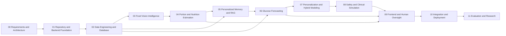

# Development roadmap

Status: The attached project brief replaces the earlier provisional ten-step scaffold with this authoritative 12-phase plan. **Current phase: 01, authorized by the user on 2026-11-01; Phase 02 is not authorized.** Durations are planning estimates for three students, not commitments; dataset permissions, compute availability and external review may extend them. Suggested roles are A (backend/data/security), B (vision/nutrition/UI), C (forecasting/evaluation); rotate review and avoid single-person knowledge ownership.

Each phase requires implemented-scope tests or Phase 00 documentation checks, documented limitations, no unresolved blocker for that phase, and explicit user approval before progression. Safety/authorization/unit validation accompanies every feature from its introduction; it is never postponed until Phase 08. Conditional research extensions can be formally deferred with rationale rather than silently treated as delivered.

## Phase 00 — Requirements and Architecture

- **Objectives:** Inspect existing work; document requirements, five tiers, contracts and research boundaries.
- **Prerequisites:** Project brief and existing repository instructions.
- **Implementation tasks:** Create directory markers/config; SRS, architecture, data/API proposals, research/privacy plans and ADRs.
- **Expected deliverables:** Reviewed documentation foundation; local documentation validation report.
- **Dependencies:** No prior phase; expert review can remain gated for later clinical/data work.
- **Acceptance criteria:** No runnable application; consistency/link checks pass, limitations tracked, user approves next phase.
- **Suggested ownership:** A: contracts/structure; B: vision/data research; C: ML/memory evaluation; cross-review all documents.
- **Approximate duration:** 1–2 weeks.

## Phase 01 — Repository and Backend Foundation

- **Objectives:** Establish a minimal typed API and deterministic developer workflow.
- **Prerequisites:** Phase 00 reviewed and user authorizes Phase 01.
- **Implementation tasks:** Select/pin lightweight toolchain; minimal health API, configuration validation, error contracts, identity/grant adapter boundary and synthetic test harness; lint/type/test CI.
- **Expected deliverables:** Runnable minimal backend and documented clean setup; no clinical inference or full frontend workflows. User-approved Phase 01 scope addition (2026-11-01): minimal connectivity shell and optional local PostgreSQL/Neo4j configuration only; no clinical features/schemas.
- **Dependencies:** Approved toolchain/version and identity approach; no full data or ML stack required.
- **Acceptance criteria:** Clean-environment setup and health/error/auth-boundary tests, Ruff/mypy/pytest and CI pass; no medical output routes.
- **Suggested ownership:** A: API/config/CI; B: fixtures/docs; C: contract and failure tests.
- **Approximate duration:** 1–2 weeks.

## Phase 02 — Data Engineering and Database

- **Objectives:** Establish canonical synthetic event storage and governed ingestion.
- **Prerequisites:** Phase 01 checks pass; data contracts and study/grant schema approved.
- **Implementation tasks:** Verify PostgreSQL/extensions; implement schemas/migrations, ownership, consent metadata, units/timestamps, atomic ingestion, provenance and audit; define dataset pipeline gates.
- **Expected deliverables:** Synthetic database/ingestion slice; migration recovery and data manifests.
- **Dependencies:** DB/TimescaleDB compatibility, governance and approved input policies for enabled features.
- **Acceptance criteria:** Unit/integration/safety regressions pass for units, times, scope, revisions, consent and recovery; no real data acquired without separate approval.
- **Suggested ownership:** A: storage/access/migrations; B: provenance/nutrition reference schema; C: temporal pipeline validation.
- **Approximate duration:** 2–3 weeks.

## Phase 03 — Food Vision Intelligence

- **Objectives:** Evaluate food validation, classification and segmentation.
- **Prerequisites:** Phase 02 synthetic contracts; authorized dataset/license decision.
- **Implementation tasks:** Safe image pipeline; simple food baseline, candidate segmentation/classification, confidence and unknown-food handling; offline grouped evaluation.
- **Expected deliverables:** Versioned research food-recognition pipeline, reports/model cards and correction-ready API.
- **Dependencies:** Dataset access and label taxonomy; optional compute budget, no promised model superiority.
- **Acceptance criteria:** Grouped held-out evaluation and malformed/unsupported-image regressions pass against prespecified targets; no portion accuracy claim from classification alone.
- **Suggested ownership:** B: vision lead; C: experiment/split review; A: upload/API/security.
- **Approximate duration:** 3–4 weeks.

## Phase 04 — Portion and Nutrition Estimation

- **Objectives:** Estimate nutrients with explicit portion/reference uncertainty and human confirmation.
- **Prerequisites:** Phase 03 candidate food outputs; reference permissions and units approved.
- **Implementation tasks:** Evaluate portion baselines and optional multimodal candidate; versioned reference mapping; component correction/confirmation; experimental FPU only if separately defined and approved.
- **Expected deliverables:** Portion/nutrition research pipeline, confirmation contracts and held-out nutrient error reports.
- **Dependencies:** Food composition access, measured portion data and human-review definitions.
- **Acceptance criteria:** Measured/reference evaluation plus missing-portion/unit/revision safety tests pass; confirmed revisions traceable; no dosing output.
- **Suggested ownership:** B: nutrition/portion lead; A: confirmation persistence/API; C: uncertainty/evaluation.
- **Approximate duration:** 3–4 weeks.

## Phase 05 — Personalized Memory and RAG

- **Objectives:** Retrieve authorized historical metabolic evidence without patient/time leakage.
- **Prerequisites:** Phase 02 canonical records and Phase 04 confirmed meal revisions.
- **Implementation tasks:** Define episodes; build revision-aware graph/pgvector indexes, structured filters, embedding manifests, evidence ranking and canonical rechecks.
- **Expected deliverables:** Evaluated retrieval profiles, protected evidence API and rebuild/deletion procedures.
- **Dependencies:** Neo4j/embedding licensing, episode definition, retrieval profile evaluation.
- **Acceptance criteria:** Foreign/future/late-annotation leakage tests have zero violations; relevance/latency evaluated against structured-only baseline; stale-index/outage behavior explicit.
- **Suggested ownership:** A: stores/index/scope; C: embedding/ranking/evaluation; B: food ontology/episode review.
- **Approximate duration:** 3–4 weeks.

## Phase 06 — Glucose Forecasting

- **Objectives:** Compare reproducible forecasts at 30/60/90/120 minutes.
- **Prerequisites:** Phase 02 validated CGM/context pipeline; Phase 05 for retrieval-enabled comparisons.
- **Implementation tasks:** Persistence and linear baselines; XGBoost/sequence candidates as feasible; patient/time splits; uncertainty calibration; gated forecast contract.
- **Expected deliverables:** Reproducible metrics, model cards, immutable inference artifact and experimental forecast API.
- **Dependencies:** Authorized CGM data, approved input eligibility/uncertainty policy, sufficient measured hardware.
- **Acceptance criteria:** Prespecified per-horizon/subgroup/calibration evaluations and safety regressions pass; no dose fields; baseline comparisons and failure coverage reported.
- **Suggested ownership:** C: forecasting lead; A: serving/snapshots; B: nutrition-error and input-quality ablations.
- **Approximate duration:** 4–6 weeks.

## Phase 07 — Personalization and Hybrid Modeling

- **Objectives:** Investigate historical adaptation and physiology-informed candidates.
- **Prerequisites:** Phase 06 reproducible population baselines; eligible per-patient chronological histories.
- **Implementation tasks:** Separate cold-start/generalization and personalization tracks; bounded adaptation, hybrid candidates, retrieval/nutrition/context ablations and drift study.
- **Expected deliverables:** Comparison report with reproducible adaptation protocol; optional research artifact if justified.
- **Dependencies:** Clinical/physiology assumptions reviewed; data sufficiency; no guaranteed advanced-model gain.
- **Acceptance criteria:** No future information in adaptation; calibrated held-out comparisons and subgroup/cold-start limits documented; retain simpler model if evidence favors it.
- **Suggested ownership:** C: methods lead; A: leakage/adaptation review; B: context and subgroup analysis.
- **Approximate duration:** 3–5 weeks.

## Phase 08 — Safety and Clinical Simulation

- **Objectives:** Consolidate cross-tier safety evidence and conditionally evaluate approved research protocols.
- **Prerequisites:** Earlier features already include safety gates; Phase 06/07 evidence; independent clinician-defined protocol approval for any simulation.
- **Implementation tasks:** Review hazards and deterministic policies; test end-to-end abstention; implement restricted simulation only if approved; trace uncertainty/assumptions and reviewer roles.
- **Expected deliverables:** Safety regression report and restricted simulation evidence or explicit deferral if approval absent.
- **Dependencies:** External qualified review is a hard gate; students cannot self-approve clinical definitions.
- **Acceptance criteria:** No autonomous actuation or patient-facing doses; no guessed parameters; qualified review of any insulin estimate; failure/retry/cache paths fail closed.
- **Suggested ownership:** A: deterministic gate integration; C: uncertainty/simulation evidence; B: human-review scenario testing; qualified clinician approves protocols.
- **Approximate duration:** 2–4 weeks after approvals.

## Phase 09 — Frontend and Human Oversight

- **Objectives:** Build accessible web research review and correction workflows.
- **Prerequisites:** Stable Phase 04/05/06 contracts and Phase 08 safety review for enabled capabilities.
- **Implementation tasks:** Next.js/TypeScript review UI, meal confirmation, history, uncertainty/evidence displays, abstention and audit views; no participant dosing workflow.
- **Expected deliverables:** Web prototype with synthetic end-to-end demonstrations and usability report.
- **Dependencies:** Node/UI version compatibility, approved audience and review/emergency wording.
- **Acceptance criteria:** Type/build checks and Playwright correction/abstention/access tests pass; labels and units preserved; human acknowledgement cannot bypass gates.
- **Suggested ownership:** B: UX/components lead; A: auth/API integration; C: forecast/uncertainty visualization and tests.
- **Approximate duration:** 3–4 weeks.

## Phase 10 — Integration and Deployment

- **Objectives:** Validate integrated research environment and propose deployment.
- **Prerequisites:** Earlier slices reviewed; Phase 09 end-to-end synthetic flow; explicit deployment authorization before settings changes.
- **Implementation tasks:** Review Compose/runtime settings, least privilege, secrets, approved telemetry, resource bounds, backup/recovery and incident procedures; synthetic integration/load tests.
- **Expected deliverables:** Reviewable runtime proposal, operations/recovery guide and integrated test evidence; deploy only when authorized.
- **Dependencies:** Hosting/data residency/budget decisions and explicit settings/deployment approval.
- **Acceptance criteria:** Unit/integration/safety/UI checks, privacy redaction and recovery checks pass; approved exact settings; no unsupported compliance or clinical availability claims.
- **Suggested ownership:** A: runtime/security lead; B: UI/integration; C: artifact/inference/observability.
- **Approximate duration:** 2–3 weeks.

## Phase 11 — Evaluation and Research

- **Objectives:** Produce reproducible research findings and limitations.
- **Prerequisites:** Frozen model/data/code manifests, approved study access and integrated prototype evidence.
- **Implementation tasks:** Locked final evaluations, subgroup/ablation/calibration analysis, usability and failure analysis, documentation and research report.
- **Expected deliverables:** Reproducible aggregate results, model/dataset documentation, limitations and future-work proposal.
- **Dependencies:** Supervisor/qualified review and permission to publish aggregates/artifacts; no automatic clinical deployment.
- **Acceptance criteria:** Independent review of splits/provenance and metrics; negative results reported; no clinical validation claim; all release limitations documented.
- **Suggested ownership:** C: quantitative report lead; B: food/nutrition/usability; A: reproducibility/security/architecture; all cross-review.
- **Approximate duration:** 3–4 weeks.

## Dependency diagram

Cross-links identify technical dependencies, not permission to skip phase gates or implement phases concurrently. Full-range schedule should be revisited after Phase 01 measurements and dataset/clinical-review availability. Phase 08 simulation can remain deferred without changing the non-negotiable safety boundaries, but that deferral requires documented review before advancing dependent capabilities.
